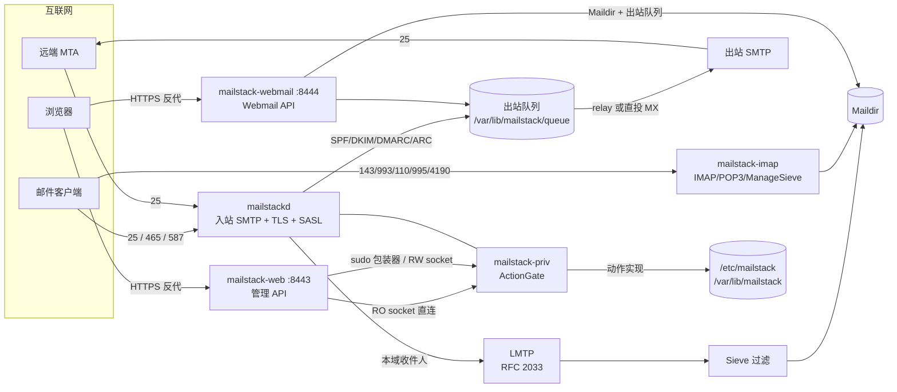

<picture>
  <source media="(prefers-color-scheme: dark)" srcset="webui/public/logo-dark.png">
  
</picture>

# MailStack

**自托管邮件服务器 —— Rust 全栈重写。** 一个进程组自研承载 SMTP 收信与提交、出站队列与退信、
IMAP/POP3/ManageSieve、SPF/DKIM/DMARC/ARC，并自带管理控制台与 Webmail。

> **v1.0.0（2026-11-03）** · 取代 legacy Node/Python 栈（`v0.8.0-beta.10`）· MIT License
> 生产运行时**不需要 Node / npm / Python**；前端只在构建机产出静态产物。

MailStack 以自研 Rust 栈**替代** Postfix / OpenDKIM / fail2ban / Dovecot 的协议面与运维面；
迁移期允许与 Postfix 双跑（见[迁移](#从-legacy-迁移)）。

---

## 核心特性

### 邮件传输（SMTP / TLS）

- **入站 SMTP**：25（STARTTLS）、465（隐式 TLS）、587（STARTTLS）三端口共用**同一份**限速与封禁表，
  轮换端口绕不过限速。
- **TLS**：全链路 `rustls`（TLS 1.2 起）+ `ring`，不引入 `aws-lc-rs` 的 cmake/nasm 构建依赖；
  根证书内置 Mozilla 根（`webpki-roots`），不依赖系统 CA 存储。
- **收信判定**：入站做 SPF / DKIM / DMARC / ARC 校验与封印（替代 OpenDKIM）；
  DMARC 策略按类型化结果判定，`Authentication-Results` 值按 RFC 8601 引用防注入；
  SMTP 走私（裸 LF）防护、DATA 字节流限额、RCPT 收件人名录查验（消目录枚举与 backscatter）。
- **提交端口**：RFC 4954 SASL，**仅在 TLS 之上**接受凭据；25 口不开放认证。
  口令真相源只有一份 `/etc/mailstack/mailbox-passwords.json`（PBKDF2-SHA256），
  提交端口、IMAP/POP3/ManageSieve 校验的是同一份记录，改密后所有协议面同时生效。
- **出站**：有 `relayhost` **只能**走中继；否则按收件域逐级解析 MX 直投（含 RFC 7505 null MX 处理）。
  两条路**互不兜底**（INV-18/INV-21），私网/环回 MX 一律拒绝（SSRF 防线）。
- **队列**：持久化、原子写、指数退避 + 按条目抖动去共振、投递租约（崩溃后不会整批重投）、
  并发上限、快速失败与「出站 25 被封锁」结论、RFC 3464 格式 DSN 退信（防退信回环/头注入）。
- **出站必签 DKIM**：队列 runner 在出站前统一签名，Webmail/API 不各自签名。

### IMAP / POP3 / ManageSieve（自研，替代 Dovecot 协议面）

- **IMAP4rev1**：核心命令 + `LITERAL+`、`UIDPLUS`、`MULTIAPPEND`、`MOVE`、`UNSELECT`、`ID`、
  `ENABLE`、`SASL-IR`、`SPECIAL-USE`、`CHILDREN`、`LIST-EXTENDED`、`ESEARCH`、
  `CONDSTORE`、`QRESYNC`、`QUOTA`、`SORT`/`THREAD`、`SORT=DISPLAY`、`METADATA`、`ACL`、
  `SCRAM-SHA-256`、`COMPRESS=DEFLATE`、`BINARY`/`BINARY.SIZE`、`SEARCHRES`；
  STARTTLS 与隐式 TLS。
- **POP3**：RFC 1939 + `CAPA`、`STLS`、`TOP`、`UIDL` 与独占锁。
- **ManageSieve**（4190）：上传即校验，脚本只落在本人 Maildir 的 `sieve/` 下。
- **LMTP**（RFC 2033，TCP/Unix socket）直接投递 Maildir，并在投递前执行 Sieve 安全子集
  （`fileinto` / `reject` / `redirect` / `vacation` / `body`）；脚本缺失或编译失败时回退 INBOX，
  **绝不因脚本问题丢信**。
- **多账号单监听器**：会话认证成功后按登录名切换到本人 Maildir，解析不到邮箱即拒绝登录。
- **Dovecot 离线迁移**：`mailstack-imap --migrate-maildir` 接管 UID 映射与关键字表（幂等）。
- **Prometheus 指标**：`/metrics` 只绑回环（默认 `127.0.0.1:9100`），按协议聚合。

### 管理控制台（Admin Console）

- React 19 + Vite 7 + Tailwind CSS 4 单页应用，由 `mailstack-web` 托管（默认只绑 `127.0.0.1:8443`）。
- 全部管理 API 由 Rust 后端提供：初始化向导、域名/别名/邮箱用户、设置、2FA、DKIM 轮换、
  ACME 证书、服务与队列动作、手工封禁、备份/恢复、日志、遥测。
- 前端产物是**外部输入**：后端只负责路径安全、内容类型与「`/api` 兜底永远是 JSON 404」；
  省略 `--dist` 时只提供 API，页面请求回 **503**（不是空白 200）。
- 中英双语、明暗主题（`data-theme`）。

### 部署与服务器管理（v1.0.0）

- **一行安装**：`curl ... | sudo bash -s -- --domain ... --admin-user ... --admin-password ... --access-mode ...`
  完成系统用户/目录/权限/二进制/包装器/sudoers/systemd/前端/管理员/身份 DKIM/访问层全部前提。
- **`mailstack-manage`**：面板式中文菜单（装完可直接进入），改域名、加/删邮箱账号、
  重设口令、签发/续期 TLS、切换访问方式、备份/升级/体检；状态源 `/etc/mailstack/install-args.conf`。
- **六种访问方式**：SSH 隧道（默认）、Caddy、nginx、公网 IP+ACME、独立面板域名
  （`panel.example.com`，与 `mail/imap/smtp.example.com` 区分）、Cloudflare Tunnel。
  8443/8444 恒只绑回环，公网 TLS 由反代/Tunnel 终结。

### Webmail（v1.0.0 新增）

- **独立进程** `mailstack-webmail`，默认只绑 `127.0.0.1:8444`，与**管理台进程、端口、会话体系全部隔离**。
- 功能对齐主流邮箱：文件夹树 + 未读徽标 + 配额、邮件列表（多选/批量操作/星标/附件图标）、
  阅读窗格（sandbox iframe 展示消毒后 HTML、远程图片默认阻断、纯文本回退、附件下载）、
  写信（富文本、附件、草稿、Ctrl+Enter 发送）、搜索、键盘快捷键、移动端单栏、中英双语与明暗主题。
- 安全模型：**服务端 HTML allowlist 消毒** + 前端 `sandbox=""` iframe + 远程图片默认阻断 +
  CSRF token + 会话纪元（改密/锁定即踢下线）；附件总量与请求体双上限；路径穿越拒绝。
- 发信只**入出站队列**（DKIM 由队列统一签名），并保存一份到 `Sent`；队列成功、`Sent` 失败时
  返回 202 + warning，**不回滚已入队邮件**（宁可 Sent 少一份，不可丢信）。
- 详见 [`docs/WEBMAIL.md`](docs/WEBMAIL.md)。

### 安全与运维

- **特权边界**：只读动作直连 `/run/mailstack/helper-ro.sock`（`0660 root:mailstack-admin`）；
  变更动作恒经 `sudo /usr/local/libexec/mailstack-privileged`（`0600 root:root` 的变更面 socket，
  Web 进程连不上）；未登记动作默认走只读面并被拒绝；破坏性动作强制 `confirm: true`；
  助手不可达一律 `503`，**绝不降级**为无特权执行。
- **2FA**：TOTP secret 以 AES-256-GCM 信封落盘（主密钥 `0600 root:root`），
  RFC 6238（HMAC-SHA1 / 6 位 / 30 秒 / ±1 步）+ 重放记账；恢复码只以 SHA-256 落盘、持锁一次性消费。
- **审计哈希链**：特权动作逐条入链，`.head` 锚文件可检测截尾。
- **fail-closed**：缺 `setup.json`、证书、域名表为空、`relay.json` 损坏等一律拒绝启动，不带病运行。
- **ACME**：`setup.cert.issue` / `certs.renew` 调用本机 `acme.sh` 签发与续期。
- **备份**：`backup.create` 打包配置与（可选）邮件，支持口令加密；恢复把归档当**不可信输入**
  （成员白名单、链接/设备拒绝、先验 SHA256、两阶段 + `O_NOFOLLOW`）。
- **供应链**：`Cargo.lock` 提交、`cargo-deny` + `cargo audit` 在 CI 强制；v1.0.0 修掉 7 条 RUSTSEC 通告。

## 服务与端口

| 服务 | 进程 | 监听 | 说明 |
|---|---|---|---|
| SMTP 入站 | `mailstackd` | `25` | MX 收信，STARTTLS |
| SMTP 提交 | `mailstackd` | `465` / `587` | 隐式 TLS / STARTTLS，SASL |
| 管理控制台 | `mailstack-web` | `127.0.0.1:8443` | API + 前端产物，只绑回环 |
| Webmail | `mailstack-webmail` | `127.0.0.1:8444` | API + 前端产物，只绑回环 |
| IMAP | `mailstack-imap` | `143` / `993` | STARTTLS / 隐式 TLS |
| POP3 | `mailstack-imap` | `110` / `995` | STLS / 隐式 TLS |
| ManageSieve | `mailstack-imap` | `4190` | STARTTLS |
| 指标 | `mailstack-imap` | `127.0.0.1:9100` | Prometheus 文本 |

> 8443 / 8444 / 9100 **默认只绑回环**：TLS 终止交给反向代理或 SSH 隧道，进程自身不做 TLS。
> 若把它们改成 `0.0.0.0` 又不在前面加 TLS 反代，管理面与 Webmail 就是明文暴露。

## 安装

> 目标平台：**Linux x86_64**。glibc 动态产物实测下限 **glibc 2.39**；
> glibc < 2.39（如 Rocky/Oracle Linux 9）或 Alpine 请用全静态产物
> （`deploy/build.sh --musl` 自行构建，见方式二）。

### 一键安装（推荐，中文交互向导）

像宝塔 / 1Panel / 3x-ui 一样，**一条命令、一路回车/选择** 完成安装：

```bash
curl -fsSL https://raw.githubusercontent.com/SectorPace/MailStack/main/deploy/install.sh -o /tmp/mailstack-install.sh
sudo bash /tmp/mailstack-install.sh          # 无参数：进入中文安装向导
```

也可以直接管道执行（安装器会从终端 `/dev/tty` 读取你的选择，不会被脚本吞掉）：

```bash
curl -fsSL https://raw.githubusercontent.com/SectorPace/MailStack/main/deploy/install.sh | sudo bash
```

向导按顺序询问（括号内为默认值，**直接回车即默认**）：

```text
MailStack v1.0.0 安装向导

安装来源:  1) GitHub Release（默认，SHA256 校验）  2) 本地/URL 发布包
           3) 预编译二进制目录                     4) 源码构建
邮件主域名（例 example.com，必填）: example.com
邮件主机名 [mail.example.com]:            ← 回车默认
管理员用户名 [admin]:                      ← 回车默认
管理员口令（8-256 位，含字母与数字）: ******
再次输入: ******
管理台端口 [8443]:      Webmail 端口 [8444]:     安装 IMAP/POP3/ManageSieve? [Y/n]:
访问模式:  1) ssh（默认，回环+SSH 隧道）  2) caddy（自动 HTTPS）
           3) nginx   4) ip-acme   5) panel-domain   6) cloudflared
配置防火墙（ufw/firewalld）放行邮件与 Web 端口? [Y/n]

安装摘要:
  来源: binary-dir   域名: example.com   邮件主机: mail.example.com
  管理员: admin      端口: 管理台 8443 / Webmail 8444 / IMAP yes
  访问模式: ssh      前缀: /
开始安装? [Y/n]
...
安装完成。是否现在打开管理菜单？[Y/n]   ← 回车直接进入管理菜单
```

安装器自动完成全部前提：系统用户/组、目录与权限、5 个二进制、特权包装器与 sudoers
（`visudo -cf` 校验）、systemd unit、前端产物、管理员凭证、邮件身份与 DKIM、域名表、
访问层（反向代理 / Tunnel / SSH 隧道说明）与防火墙放行，最后打印访问地址。

访问模式（`--access-mode`，默认 `ssh`）：

| 模式 | 入口方式 | 说明 |
|---|---|---|
| `ssh` | SSH 隧道 | 8443/8444 只绑回环，不装反代（默认，最安全） |
| `caddy` | Caddy 反代 | 自动 ACME HTTPS（80/443 需公网可达） |
| `nginx` | nginx 反代 | TLS 由 certbot/acme.sh 补；生成站点配置 |
| `ip-acme` | 公网 IP + ACME | nginx 终止 TLS，证书走 `mailstackctl setup.cert.issue` |
| `panel-domain` | 独立面板域名 | 如 `panel.example.com`，**必须**与 `mail/imap/smtp.example.com` 不同 |
| `cloudflared` | Cloudflare Tunnel | 本机不开端口，cloudflared 连回环 8443/8444 |

### 服务器管理菜单（傻瓜式）

安装完成后输入 `sudo mailstack-manage`（或安装完成时直接回车进入）就是完整管理菜单：

```text
┌──────────────────────────────────────────────────────────────┐
│  MailStack 管理面板  v1.0.0                                  │
└──────────────────────────────────────────────────────────────┘
  主机: mail.example.com        前缀: /
  域名: example.com             邮件主机: mail.example.com
  访问: caddy                   管理台: https://panel.example.com/
  身份: 已配置   管理员: admin（已配置）

  1) 状态总览            2) 域名管理            3) 邮箱账号
  4) 访问与 TLS          5) 服务管理            6) 备份与恢复
  7) 更新/升级           8) 安全                9) 修复/卸载
  i) 初始化向导（首次配置域名/DKIM/域名表）          0) 退出
```

- **i) 初始化向导**：新机器第一次用，按提示填域名/邮件主机/IP，自动生成 DKIM 并登记域名表。
- **2) 域名管理 / 3) 邮箱账号**：改域名、加/删邮箱、重设口令，全部菜单操作。
- **4) 访问与 TLS**：切换 ssh/caddy/nginx/ip-acme/panel-domain/cloudflared，签发/续期证书。
- **5) 服务管理 / 6) 备份与恢复 / 7) 更新升级 / 8) 安全 / 9) 修复卸载**：日常运维全覆盖。

菜单里的每个动作都可以脚本化（幂等），适合自动化：

```bash
sudo mailstack-manage status --json
sudo mailstack-manage doctor
sudo mailstack-manage domain set example.com --mail-host mail.example.com
sudo mailstack-manage account add alice@example.com --password-stdin
sudo mailstack-manage tls issue mail.example.com --email ops@example.com
sudo mailstack-manage access set caddy --panel-host panel.example.com --acme-email ops@example.com
sudo mailstack-manage service restart|status|logs mailstackd
sudo mailstack-manage backup create|list|restore|delete
sudo mailstack-manage update check|apply
sudo mailstack-manage repair | security | uninstall
```

### 方式一：全自动一行安装（参数式，适合脚本/CI）

```bash
curl -fsSL https://raw.githubusercontent.com/SectorPace/MailStack/main/deploy/install.sh \
  | sudo bash -s -- \
      --domain mail.example.com \
      --mail-host mail.example.com \
      --admin-user admin \
      --admin-password 'My-Admin-Pass-9' \
      --access-mode caddy \
      --acme-email ops@example.com
```

口令会经 argv 暴露，介意时先落盘再用 `--admin-password-stdin`（或环境变量
`MAILSTACK_ADMIN_PASSWORD`）：

```bash
VERSION=1.0.0
curl -fsSL "https://raw.githubusercontent.com/SectorPace/MailStack/v${VERSION}/deploy/install.sh" -o /tmp/mailstack-install.sh
printf '%s\n' "$MAILSTACK_ADMIN_PASSWORD" | sudo bash /tmp/mailstack-install.sh \
  --non-interactive --domain mail.example.com --admin-user admin --admin-password-stdin
```

其它参数：`--interactive`（有参数时也进向导）、`--from-source`、`--archive FILE|URL`、
`--binary-dir DIR`、`--mirror`、`--prefix`（staging）、`--upgrade` / `--repair` / `--dry-run`、
`--no-systemd`、`--no-access-provision`、`--no-firewall`、`--yes`、`--admin-port`/`--webmail-port`、
`--webmail-host`、`--server-ip`、`--uninstall`/`--purge`。完整说明见 `deploy/install.sh --help`
与 [`docs/INSTALL.md`](docs/INSTALL.md)。

### 方式二：源码构建

```bash
# 依赖：Rust 1.98.1（build.sh 与 CI 固定）、C 编译器；前端构建另需 Node.js
git clone https://github.com/SectorPace/MailStack.git
cd MailStack
deploy/build.sh                # 产出 dist/：5 个二进制 + 发布 tarball + SHA256SUMS + SBOM
cd webui && npm ci && npm run build && cd ..
sudo deploy/install.sh --binary-dir dist --domain mail.example.com --admin-user admin \
  --admin-password 'My-Admin-Pass-9' --access-mode ssh
```

> 发布资产同时提供全静态 musl tarball（glibc < 2.39 / Alpine）：`--archive <musl-tarball>`。

## 部署后首次配置

1. **打开管理台**：`http://127.0.0.1:8443`（经 SSH 隧道或反向代理访问；
   公网部署必须由反向代理终结 TLS）。
2. **初始化向导**（首次打开自动进入）：
   1. 填写**主域名**与**邮件主机名**（MX 主机名），生成 DKIM 密钥并写入身份；
   2. 按向导给出的 A / MX / SPF / DKIM / DMARC 记录到 DNS 服务商配置，
      用「DNS 检查」逐条验证（`setup.dns.verify`）；
   3. 配置出站方式：中继（分阶段测试 DNS → connect → TLS → auth，先测后写）或直投；
   4. 需要时用 ACME 签发证书（要求 DNS 已指向本机、80/443 可用）；
   5. 设置管理员 2FA（TOTP + 恢复码）。
3. **创建邮箱用户**：管理台「用户」，或用 CLI：

   ```bash
   sudo mailstackctl users.add '{"email":"alice@example.com","password":"<强口令>"}'
   ```

4. **打开 Webmail**：`http://127.0.0.1:8444`，用完整邮箱地址 + 口令登录
   （同样经隧道/反代访问；Webmail 只绑回环）。
5. **邮件客户端**：IMAP `imap://mail.example.com:143`（STARTTLS）或 `imaps://…:993`；
   SMTP 提交 `587`（STARTTLS）或 `465`（隐式 TLS）；口令与 Webmail 相同。

## 质量复审

v1.0.0 发行前完成全量 OCR 复审（287 文件 / 1411 条意见），修复 13 项确认缺陷，
质量分 **91/100**（无未修复 critical/high）。细节见 [`docs/OCR_REVIEW.md`](docs/OCR_REVIEW.md)。

## 架构



数据流一句话：**入站 SMTP 认证与判定 → 入队 →（本地 LMTP/Sieve → Maildir）或（中继/直投 → 远端）；
Webmail 与客户端都只读写 Maildir 与出站队列；所有变更动作经同一个特权动作门控。**

### crate 与二进制职责

11 个 crate：

| crate | 包名 | 职责 |
|---|---|---|
| `crates/core` | `mailstack-core` | 领域模型、配置 schema、口令策略、审计哈希链、原子写/锁、命令原语、2FA、证书、`/proc` 采样、备份归档、手工封禁 |
| `crates/priv` | `mailstack-priv` | 特权边界：动作门控（白名单/通道/confirm）、RPC 帧、RO/RW socket 服务端、全部动作处理器 |
| `crates/smtp` | `mailstack-smtp` | SMTP 客户端：IP 固定拨号、中继校验、分阶段测试、出站探测、MX 解析与直投目标、SSRF 地址策略、DNS 查询 |
| `crates/smtpd` | `mailstack-smtpd` | 入站 SMTP 服务端：命令/会话状态机、DATA 字节流、TLS、限速与自动封禁、SASL、SPF/DKIM/DMARC 判定与入队 |
| `crates/queue` | `mailstack-queue` | 出站队列：持久化、退避重试、投递租约、DSN 退信、并发限流、快速失败、DKIM 签名 |
| `crates/store` | `mailstack-store` | 数据层：域名/别名表文件、本地收件人名录、LMTP 客户端 |
| `crates/auth` | `mailstack-auth` | 认证与签名：DKIM 密钥与签名、SPF、DMARC、ARC（校验与封印）、离线 TXT 缓存 |
| `crates/web` | `mailstack-web` | 管理 API：契约路由表、会话/CSRF、登录限流、错误模型、RPC 桥、时序遥测 |
| `crates/imappop3` | `mailstack-imappop3` | 协议实现：IMAP4rev1 / POP3 / LMTP / Sieve / ManageSieve / Maildir / ACL / 迁移 |
| `crates/imapd` | `mailstack-imapd` | 协议装配层：把 `imappop3` 接到本栈的账号、Maildir、证书与 metrics 上 |
| `crates/webmail` | `mailstack-webmail` | Webmail 后端库：认证/会话、Maildir 服务、MIME 视图、HTML 消毒、写信/发送入队 |

5 个二进制：

| 二进制 | 职责 |
|---|---|
| `mailstackd` | 入站 SMTP（25/465/587）+ 出站队列调度 + 特权 RPC 双通道 + LMTP + 封禁热重载 |
| `mailstackctl` | CLI：调用白名单动作（只读直连 RO socket，变更经 sudo 包装器；`--privileged-stdin` 为包装器协议模式） |
| `mailstack-web` | 管理 API + 管理台静态产物托管（默认 `127.0.0.1:8443`） |
| `mailstack-imap` | IMAP/POP3/ManageSieve 守护进程（143/993/110/995/4190）+ metrics + Dovecot 迁移入口 |
| `mailstack-webmail` | Webmail API + Webmail 静态产物托管（默认 `127.0.0.1:8444`） |

前端（`webui/`）：一次 `npm run build` 产出两个入口 —— 管理台 `index.html`、Webmail `mail.html`。

## 安全设计要点

- **fail-closed**：拿不准就拒绝。助手不可达 → `503`；配置/证书/域名表异常 → 拒绝启动；
  读不到数据 → 明确 `unavailable`，不静默当成「没问题」。
- **特权模型**：RO socket 与 RW socket 分离；未登记动作默认走只读面（静默提权防护）；
  动作名编译期绑定，处理器不读请求体里的动作名；破坏性动作强制 `confirm: true`。
- **审计哈希链**：`/var/log/mailstack-rpc-audit.log` + `.head` 锚文件，可检测截尾。
- **2FA 与恢复码**：见[核心特性](#安全与运维)。
- **会话**：Cookie 带 `__Host-` 前缀（HTTPS 模式）+ `HttpOnly` + `SameSite=Strict`；
  CSRF token 与会话绑定；改密/2FA 变更按用户吊销全部会话。
- **Webmail 内容安全**：服务端 HTML parser 级 allowlist 消毒（脚本/样式/iframe/表单/
  事件属性全丢）、URL 协议白名单、远程图片默认阻断、附件强制 `nosniff` +
  `Content-Disposition`、`sandbox=""` iframe、CSP。
- **SSRF 防线**：直投 MX 走地址策略白名单（环回/私网/link-local/CGNAT/IPv6 内嵌 IPv4 一律拒绝）。
- **供应链**：`cargo-deny`（漏洞/许可/通配/来源）+ `cargo audit` 在 CI 强制；
  GitHub Actions 全部 pin 到 commit SHA；发布包附 `SHA256SUMS`。

安全披露流程与加固清单见 [`SECURITY.md`](SECURITY.md)。

## 运维常用命令

```bash
# 服务状态与日志
systemctl status mailstackd mailstack-web mailstack-imap mailstack-webmail
journalctl -u mailstackd -f
journalctl -u mailstack-webmail -f

# 只读视图（动作走 RO socket；socket 属 root:mailstack-admin，普通用户仍需 sudo）
sudo mailstackctl snapshot --compact
sudo mailstackctl domains.list
sudo mailstackctl users.list
sudo mailstackctl queue.list
sudo mailstackctl services.list
sudo mailstackctl backup.list

# 变更动作（经 sudo 包装器 → 变更面）
sudo mailstackctl domains.add '{"domain":"example.com"}'
sudo mailstackctl users.add '{"email":"alice@example.com","password":"<强口令>"}'
sudo mailstackctl dkim.rotate '{"domain":"example.com"}'

# 备份（public 模式必须给口令；includeMails 同时打包受管账号 Maildir）
sudo mailstackctl backup.create '{"includeMails":true,"passphrase":"<强口令>"}'
sudo mailstackctl backup.list

# 破坏性动作必须显式 --confirm
sudo mailstackctl users.delete '{"email":"alice@example.com"}' --confirm
```

```bash
# 健康检查 / 指标
curl -fsS http://127.0.0.1:8443/api/health
curl -fsS http://127.0.0.1:9100/metrics | head
```

> `mailstackctl` 退出码：`0` 成功 / `1` 动作失败 / `2` 用法错误 / `3` 助手不可达 / `4` 中途超时。
> 审计链：`/var/log/mailstack-rpc-audit.log`（`0600`）。

## 已知限制（诚实披露）

- **直投不做机会式 TLS**：直投链路为明文投递（中继侧支持 TLS）；对传输机密性敏感请配置支持 TLS 的中继。
- **未做真实公网 MX 端到端联调**：MX 解析、优先级、逐域退避均有测试与注入验证，但没有用真实公网域名跑完整投递；
  真实 Dovecot 生产数据迁移与审计链升级演练同样未做。
- **Webmail / 管理台不内建 TLS 终止**：只绑回环，公网访问必须经反向代理或 SSH 隧道。
- **DMARC `pct=` 抽样仅离线注入路径可用**：生产路径受上游 `mail-auth 0.13.3` 限制按 100% 执行已公布策略
  （更严格方向；见 `crates/auth/src/dmarc.rs` 与测试 `pct_is_not_available_on_the_network_parse_path`）。
- **IMAP 范围**：共享邮箱的结构性操作（CREATE/DELETE/RENAME/SUBSCRIBE）与跨存储 COPY/MOVE 明确返回 `NO`；
  未实现 IMAP4rev2 与 JMAP。
- **部分 medium/low 审查项未在本版修复**：本轮以 critical/high 优先；其余在 R1–R7 报告与
  `docs/REVIEW_FIXES.md` §5 登记，随 v1.0.x 跟进（例：队列调度全量读内存、IMAP 标志变更的全表重写）。
- 完整清单见 [`CHANGELOG.md`](CHANGELOG.md) §已知限制 与 [`docs/TEST_REPORT.md`](docs/TEST_REPORT.md) §5。

## 测试与质量门禁

v1.0.0 发布门禁实测（Ubuntu 26.04 / WSL2 + Rust 1.98.1，2026-11-03）：

| 指标 | 实测值 |
|---|---|
| `cargo test --workspace --all-targets` | **1648 通过 / 0 失败**（含真实 TLS/TCP/unix socket 集成测试；AI 功能移除后减少 55 项） |
| 前端 `npm test`（vitest） | **187 通过 / 0 失败** |
| 特权动作白名单 | **52 条**（只读 20 + 变更 32；AI 功能已移除） |
| HTTP 契约路由 | **62 条**（含 2 条免认证；AI 路由已移除） |
| 安全不变量清单 | **293 条**（`deploy/verify-invariant-gate.sh` 全部通过） |

v1.0.0 发布前通过的门禁（CI 与本地同一命令链，Ubuntu + Rust 1.98.1）：

| 门禁 | 命令 | 期望 |
|---|---|---|
| 格式 | `cargo fmt --all -- --check` | 通过 |
| Lint | `cargo clippy --all-targets -- -D warnings` | 通过（warnings 即失败） |
| 单元/集成测试 | `cargo test --workspace --all-targets` | 全部通过（含真实 TLS/TCP/unix socket 集成测试） |
| 前端 | `cd webui && npm run build` + `npm test` | 通过（tsc 类型检查 + Vite 构建 + vitest） |
| 不变量存在性 | `deploy/verify-invariant-gate.sh` | 清单内每个安全测试真实存在且带断言 |
| 交付物 | `deploy/verify-deliverables.sh` | `DELIVERABLES_OK` |
| 供应链 | `cargo deny check` + `cargo audit` | advisories/bans/licenses/sources 全通过 |

测试与审查记录：

- [`docs/TEST_REPORT.md`](docs/TEST_REPORT.md) —— 测试规模、门禁结果、缺陷复盘与**未验证事项**（诚实披露）。
- [`docs/REVIEW_FIXES.md`](docs/REVIEW_FIXES.md) —— 外部审查加固台账。
- v1.0.0 发布前完成 **7 份独立代码审查**（R1–R7，共 144 条发现，含 1 条 critical / 26 条 high），
  修复以 critical/high 优先；其余条目在审查报告中登记，随 v1.0.x 跟进。本轮审查另发现并修复
  Webmail 新代码中的 1 处**真实死锁**（会话纪元缓存二次加锁）与 Sanitizer 跳过模式解析 bug。

## 文档索引

| 文档 | 内容 |
|---|---|
| [`docs/INSTALL.md`](docs/INSTALL.md) | 详细安装 / 升级 / 卸载 / 离线安装 |
| [`docs/DEPLOYMENT.md`](docs/DEPLOYMENT.md) | 部署：systemd、目录与权限、端口、迁移与回滚、libc 兼容性 |
| [`docs/WEBMAIL.md`](docs/WEBMAIL.md) | Webmail 功能、架构、安全模型、API 摘要与运维 |
| [`docs/TEST_REPORT.md`](docs/TEST_REPORT.md) | 测试报告与未验证事项 |
| [`docs/HANDOVER.md`](docs/HANDOVER.md) | 项目移交：进度、架构、模块与风险 |
| [`docs/REVIEW_FIXES.md`](docs/REVIEW_FIXES.md) | 外部审查加固台账（修复清单 + 未修项） |
| [`docs/WEBUI_AUDIT.md`](docs/WEBUI_AUDIT.md) | 管理前端审计报告 |
| [`docs/IMAPPOP3_INTEGRATION.md`](docs/IMAPPOP3_INTEGRATION.md) | IMAP/POP3 接管与 Dovecot 迁移说明 |
| [`CHANGELOG.md`](CHANGELOG.md) | 版本变更记录（含 legacy 历史索引） |
| [`SECURITY.md`](SECURITY.md) | 安全策略、私有披露与加固清单 |
| [`TOOLCHAIN.md`](TOOLCHAIN.md) | 工具链固定说明 |

## 目录结构

```text
mailstack/
├── Cargo.toml            # workspace（11 crate + 5 bin）
├── VERSION               # 1.0.0（与 Cargo / webui package.json 一致，由门禁校验）
├── crates/               # 11 个库 crate（见上表）
├── bin/                  # 5 个二进制：mailstackd / mailstackctl / mailstack-web / mailstack-imap / mailstack-webmail
├── webui/                # 前端（管理台 + Webmail 同一次构建）
├── deploy/               # 构建、安装/卸载、systemd unit、质量门禁与验证脚本
├── docs/                 # 部署/测试/移交/审查/Webmail 文档
├── .github/workflows/    # CI：质量门禁 + 供应链 + 不变量存在性
└── LICENSE / CHANGELOG.md / SECURITY.md / README.md / README_EN.md
```

## 从 legacy 迁移

v1.0.0 是重写版，**不能原地升级** legacy `v0.8.0-beta.10`（Node/Python 栈）。迁移路径：

1. 备份旧栈数据（配置、DKIM 密钥、Maildir、管理员凭据）；
2. 按 [`docs/INSTALL.md`](docs/INSTALL.md) 安装 v1.0.0，但**先不要停旧栈**；
3. 用 `mailstack-imap --migrate-maildir` 迁移 UID/关键字（先停 Dovecot，只允许一个实现写同一 Maildir）；
4. 按 `docs/DEPLOYMENT.md` 的包装器/目录/unit 契约切换特权通道，运行 `deploy/verify-setup-wizard-e2e.sh`；
5. 确认收信、发信、IMAP/POP3、管理台与 Webmail 正常后，再停用 Postfix / OpenDKIM / fail2ban / Dovecot。
   迁移期允许与 Postfix **双跑**：MailStack 仍会写出 Postfix 格式的表文件用于兼容；
   **纯 MailStack 主机（未安装 Postfix）同样可以正常工作**（找不到 `postmap` 时按「无需同步」处理，
   而不是把域名/别名写入判为失败）。

## 许可证

MIT License，见 [`LICENSE`](LICENSE)。Copyright (c) 2026 MailStack contributors。

## 安全披露

请勿在公开 issue 披露未修复漏洞。私有披露流程、范围与部署加固清单见 [`SECURITY.md`](SECURITY.md)。
