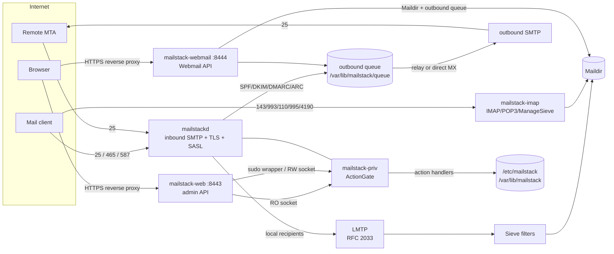

<picture>
  <source media="(prefers-color-scheme: dark)" srcset="webui/public/logo-dark.png">
  
</picture>

# MailStack

**A self-hosted mail server, rewritten in Rust from top to bottom.** One set of processes natively
implements inbound and submission SMTP, the outbound queue and bounces, IMAP/POP3/ManageSieve,
SPF/DKIM/DMARC/ARC — and ships with an admin console and Webmail.

> **v1.0.0 (2026-11-03)** · replaces the legacy Node/Python stack (`v0.8.0-beta.10`) · MIT License
> No Node / npm / Python is required at runtime; the frontend is built to static assets on the build host only.

MailStack **replaces** the protocol and operations surfaces of Postfix / OpenDKIM / fail2ban / Dovecot
with its own Rust stack; running side by side with Postfix is supported during migration
(see [Migrating from legacy](#migrating-from-legacy)).

---

## Highlights

### Mail transport (SMTP / TLS)

- **Inbound SMTP**: ports 25 (STARTTLS), 465 (implicit TLS) and 587 (STARTTLS) share **one** rate-limit
  and ban table, so rotating ports does not bypass throttling.
- **TLS**: `rustls` end to end (TLS 1.2+) with `ring`, avoiding the cmake/nasm build dependency of
  `aws-lc-rs`; trust anchors come from the bundled Mozilla roots (`webpki-roots`), not the system CA store.
- **Inbound policy**: SPF / DKIM / DMARC / ARC verification and sealing (replacing OpenDKIM);
  DMARC decisions are driven by typed results; `Authentication-Results` values are quoted per RFC 8601
  to prevent injection; SMTP smuggling (bare-LF) defenses, DATA size limits, and RCPT-time recipient
  registry checks (no directory enumeration, no backscatter).
- **Submission**: RFC 4954 SASL, credentials accepted **only over TLS**; port 25 does not offer AUTH.
  There is exactly one source of truth for passwords: `/etc/mailstack/mailbox-passwords.json`
  (PBKDF2-SHA256). Submission, IMAP/POP3 and ManageSieve all verify the same record, so a password change
  takes effect on every protocol at once.
- **Outbound**: with a configured `relayhost` **all** mail goes through the relay; otherwise MailStack
  resolves MX per recipient domain and delivers directly (including RFC 7505 null MX handling).
  The two paths **never fall back to each other** (INV-18/INV-21), and private/loopback MX targets are
  rejected (SSRF defense).
- **Queue**: durable, atomic writes, exponential backoff with per-entry jitter, delivery leases
  (a crash no longer re-delivers a whole batch), concurrency limits, fast-fail plus an explicit
  "outbound port 25 blocked" verdict, and RFC 3464 DSN bounces (loop-safe, header-injection-safe).
- **DKIM on every outbound message**: the queue runner signs centrally; Webmail/API never sign on their own.

### IMAP / POP3 / ManageSieve (native, replacing the Dovecot protocol surface)

- **IMAP4rev1**: core commands plus `LITERAL+`, `UIDPLUS`, `MULTIAPPEND`, `MOVE`, `UNSELECT`, `ID`,
  `ENABLE`, `SASL-IR`, `SPECIAL-USE`, `CHILDREN`, `LIST-EXTENDED`, `ESEARCH`, `CONDSTORE`, `QRESYNC`,
  `QUOTA`, `SORT`/`THREAD`, `SORT=DISPLAY`, `METADATA`, `ACL`, `SCRAM-SHA-256`, `COMPRESS=DEFLATE`,
  `BINARY`/`BINARY.SIZE`, `SEARCHRES`; STARTTLS and implicit TLS.
- **POP3**: RFC 1939 plus `CAPA`, `STLS`, `TOP`, `UIDL` and an exclusive lock.
- **ManageSieve** (4190): scripts are validated on upload and stored only under the user's own
  Maildir `sieve/` directory.
- **LMTP** (RFC 2033 over TCP/Unix sockets) delivers straight into Maildir and runs a safe Sieve subset
  (`fileinto` / `reject` / `redirect` / `vacation` / `body`); a missing or broken script falls back to
  INBOX — **mail is never lost because of a script**.
- **One listener, many accounts**: after authentication the session switches to the user's own Maildir;
  if no mailbox resolves, login is refused.
- **Offline Dovecot migration**: `mailstack-imap --migrate-maildir` takes over UID mappings and keywords
  (idempotent).
- **Prometheus metrics**: `/metrics` bound to loopback only (default `127.0.0.1:9100`), aggregated per protocol.

### Admin console

- React 19 + Vite 7 + Tailwind CSS 4 single-page app, served by `mailstack-web` (loopback only,
  default `127.0.0.1:8443`).
- Every admin API is served by the Rust backend: setup wizard, domains/aliases/mailbox users, settings,
  2FA, DKIM rotation, ACME certificates, service and queue actions, manual bans, backup/restore, logs,
  telemetry, and AI outbound configuration.
- The frontend bundle is treated as **external input**: the backend only guarantees path safety,
  content types, and that the `/api` fallback is always a JSON 404. Without `--dist` the service
  exposes the API only and page requests return **503** (not a blank 200).
- Bilingual UI (Chinese/English) with light and dark themes (`data-theme`).

### Webmail (new in v1.0.0)

- **A separate process**, `mailstack-webmail`, bound to `127.0.0.1:8444` by default, with process,
  port and session isolation from the admin console.
- Feature parity with mainstream webmail: folder tree with unread badges and quota, message list
  (multi-select, bulk actions, stars, attachment icons), reading pane (sanitized HTML in a
  `sandbox=""` iframe, remote images blocked by default, plain-text fallback, attachment download),
  compose (rich text, attachments, drafts, Ctrl+Enter to send), search, keyboard shortcuts,
  single-column mobile layout, bilingual UI and light/dark themes.
- Security model: **server-side HTML allowlist sanitization** + sandboxed iframe + remote images blocked
  by default + CSRF token + session epoch (a password change or lock immediately invalidates sessions);
  hard limits on attachment size and request body; path-traversal rejection.
- Sending only **enqueues** into the outbound queue (DKIM is applied centrally by the queue) and appends
  a copy to `Sent`; if the queue succeeds but `Sent` fails, the response is 202 with a warning and the
  queued message is **not** rolled back (better a missing Sent copy than a lost message).
- See [`docs/WEBMAIL.md`](docs/WEBMAIL.md) (Chinese).

### Security and operations

- **Privilege boundary**: read-only actions connect directly to `/run/mailstack/helper-ro.sock`
  (`0660 root:mailstack-admin`); mutating actions always go through
  `sudo /usr/local/libexec/mailstack-privileged` (the mutate socket is `0600 root:root` and is
  unreachable from the web process). Unregistered actions default to the read-only surface and are
  rejected; destructive actions require `confirm: true`; an unreachable helper yields `503` and
  **never** degrades to unprivileged execution.
- **2FA**: the TOTP secret is stored in an AES-256-GCM envelope (master key `0600 root:root`),
  validated per RFC 6238 (HMAC-SHA1 / 6 digits / 30 s / ±1 step) with replay accounting; recovery codes
  are stored as SHA-256 only and consumed once under a lock.
- **Audit hash chain**: every privileged action is appended to a hash chain; the `.head` anchor file
  detects truncation.
- **fail-closed**: missing `setup.json`, missing certificates, an empty domain table or a corrupt
  `relay.json` all refuse startup instead of running degraded.
- **ACME**: `setup.cert.issue` / `certs.renew` drive the local `acme.sh` installation.
- **Backups**: `backup.create` packages configuration and (optionally) mail, with passphrase-based
  encryption. Restore treats archives as **untrusted input** (member allowlist, link/device rejection,
  checksum first, two-phase extraction with `O_NOFOLLOW`).
- **Supply chain**: `Cargo.lock` is committed; `cargo-deny` + `cargo audit` are enforced in CI.
  v1.0.0 fixed 7 RUSTSEC advisories before release.

## Services and ports

| Service | Binary | Listen | Notes |
|---|---|---|---|
| Inbound SMTP | `mailstackd` | `25` | MX mail, STARTTLS |
| Submission SMTP | `mailstackd` | `465` / `587` | implicit TLS / STARTTLS, SASL |
| Admin console | `mailstack-web` | `127.0.0.1:8443` | API + static bundle, loopback only |
| Webmail | `mailstack-webmail` | `127.0.0.1:8444` | API + static bundle, loopback only |
| IMAP | `mailstack-imap` | `143` / `993` | STARTTLS / implicit TLS |
| POP3 | `mailstack-imap` | `110` / `995` | STLS / implicit TLS |
| ManageSieve | `mailstack-imap` | `4190` | STARTTLS |
| Metrics | `mailstack-imap` | `127.0.0.1:9100` | Prometheus text format |

> 8443 / 8444 / 9100 are **loopback-only by default**: terminate TLS in a reverse proxy or use an SSH
> tunnel. The processes themselves do not terminate TLS. Binding them to `0.0.0.0` without a TLS proxy
> exposes the admin console and Webmail in plaintext.

## Installation

> Target platform: **Linux x86_64**. The glibc build requires **glibc >= 2.39** (measured).
> On glibc < 2.39 (e.g. Rocky/Oracle Linux 9) or Alpine, use a fully static build
> (build one yourself with `deploy/build.sh --musl`, see Option 2).

### Option 1: one-liner installer (recommended)

```bash
# Download first, then run (recommended; prompts for the admin password by default)
VERSION=1.0.0
curl -fsSL "https://raw.githubusercontent.com/SectorPace/MailStack/v${VERSION}/deploy/install.sh" -o /tmp/mailstack-install.sh
less /tmp/mailstack-install.sh

sudo bash /tmp/mailstack-install.sh \
  --domain mail.example.com \
  --admin-user admin \
  --admin-password-stdin

# Unattended/CI: pass the password on stdin (never in argv or shell history)
printf '%s\n' "$MAILSTACK_ADMIN_PASSWORD" | sudo bash /tmp/mailstack-install.sh \
  --non-interactive --domain mail.example.com --admin-password-stdin
```

A direct one-liner is also supported (**in pipe mode stdin is consumed by the script, so the
password cannot be piped too**; create the admin via the setup wizard or run the `admin.set`
command the installer prints):

```bash
curl -fsSL https://raw.githubusercontent.com/SectorPace/MailStack/main/deploy/install.sh \
  | sudo bash -s -- --domain mail.example.com
```

What the script does (authoritative source: `deploy/install.sh --help`):

- by default downloads `mailstack-v1.0.0-x86_64-unknown-linux-gnu.tar.gz` from GitHub Releases
  and **verifies it against `SHA256SUMS`**;
- `--from-source`: build from source (requires Rust 1.98.1 + a C compiler, see Option 2);
- `--archive FILE|URL`: use an offline/explicit release archive;
- `--binary-dir DIR`: use prebuilt binaries (testing/offline installs);
- `--prefix DIR`: install the whole tree under a given root (staging/testing);
- `--no-systemd`: skip systemd units (containers or non-systemd hosts) and print manual start commands;
- `--domain` / `--mail-host`: primary domain and mail hostname (identity/DKIM are still completed
  by the setup wizard);
- `--admin-user` (default `admin`) / `--admin-password-stdin`: admin bootstrap (password 12–256 chars,
  must contain letters and digits);
- `--admin-port` / `--webmail-port`: defaults `8443` / `8444`;
- `--imap yes|no`: install and enable IMAP/POP3 (default `yes`);
- `--access-mode local|caddy|direct`: deployment mode (written as `ACCESS_MODE` into
  `install-args.conf`; affects cookie `Secure` and public-mode restrictions; kept as-is when omitted
  on re-runs);
- `--uninstall` / `--purge`: uninstall (keeps `/etc/mailstack` and `/var/lib/mailstack` by default;
  `--purge` removes them too; `deploy/uninstall.sh` is available as well).

The installer creates the system users/groups (`mailstack-admin`, `mailstack-webmail`, …), directories
and permissions, binaries under `/usr/local/bin/`, the **privileged wrapper**
`/usr/local/libexec/mailstack-privileged` plus `/etc/sudoers.d/mailstack-admin`, systemd units, and
bootstraps the admin credentials. It prints the admin console URL
`http://127.0.0.1:8443/?login=1` and the Webmail URL `http://127.0.0.1:8444` when done.

> Release assets also include `mailstack-v1.0.0-x86_64-unknown-linux-musl.tar.gz` (fully static;
> for glibc < 2.39 and Alpine). Pass it with `--archive <tarball>`.

### Option 2: build from source

```bash
# 1) Dependencies (Debian/Ubuntu example): Rust 1.98.1 (pinned by deploy/build.sh and CI), C compiler
#    rustup toolchain install 1.98.1

# 2) Clone and build (produces dist/: 5 binaries + SHA256SUMS + SBOM)
git clone https://github.com/SectorPace/MailStack.git
cd MailStack
deploy/build.sh                # add --musl for static binaries; --offline/--vendor for offline builds

# 3) Build the frontend bundles (admin index.html + Webmail mail.html in one build)
cd webui && npm ci && npm run build && cd ..

# 4) Install the built artifacts
sudo deploy/install.sh --binary-dir dist
```

> Node.js is required only on the build host; the installed production system does not need Node/npm.
> `deploy/install.sh --help` lists every available option.

## First-run configuration

1. **Open the admin console**: `http://127.0.0.1:8443` (through an SSH tunnel or reverse proxy;
   public deployments must terminate TLS in the proxy).
2. **Follow the setup wizard** (opens automatically on first visit):
   1. enter the **primary domain** and **mail hostname** (MX name); DKIM keys are generated and the
      identity is written to disk;
   2. configure the A / MX / SPF / DKIM / DMARC records suggested by the wizard, then verify them
      with the DNS check (`setup.dns.verify`);
   3. choose outbound transport: relay (staged DNS → connect → TLS → auth test, write only after the
      test passes) or direct delivery;
   4. issue certificates with ACME if needed (DNS must already point at the host; ports 80/443 reachable);
   5. enable admin 2FA (TOTP + recovery codes).
3. **Create mailbox users** in the console, or via the CLI:

   ```bash
   sudo mailstackctl users.add '{"email":"alice@example.com","password":"<strong-password>"}'
   ```

4. **Open Webmail**: `http://127.0.0.1:8444`, log in with the full email address and password
   (again through a tunnel/proxy; Webmail is loopback-only).
5. **Mail clients**: IMAP `imap://mail.example.com:143` (STARTTLS) or `imaps://…:993`;
   SMTP submission on `587` (STARTTLS) or `465` (implicit TLS); same credentials as Webmail.

## Architecture



In one sentence: **inbound SMTP authenticates and evaluates mail → enqueues it →
(local LMTP/Sieve → Maildir) or (relay/direct MX → remote MTA); Webmail and IMAP/POP3 clients only read
and write the Maildir and the outbound queue; every mutating action goes through the same privileged
action gate.**

### Crates and binaries

Eleven crates:

| Crate | Package | Responsibility |
|---|---|---|
| `crates/core` | `mailstack-core` | Domain model, config schema, password policy, audit hash chain, atomic writes/locks, command primitives, 2FA, certificates, `/proc` sampling, backup archives, manual bans |
| `crates/priv` | `mailstack-priv` | Privilege boundary: action gate (allowlist/channel/confirm/AI master switch), RPC frames, RO/RW socket servers, all action handlers |
| `crates/smtp` | `mailstack-smtp` | SMTP client: pinned-IP dialing, relay validation, staged tests, outbound probe, MX resolution and direct targets, SSRF address policy, DNS queries |
| `crates/smtpd` | `mailstack-smtpd` | Inbound SMTP server: command/session state machine, DATA byte stream, TLS, rate limiting and auto-ban, SASL, SPF/DKIM/DMARC evaluation and enqueueing |
| `crates/queue` | `mailstack-queue` | Outbound queue: persistence, retry/backoff, delivery leases, DSN bounces, concurrency limits, fast-fail, DKIM signing |
| `crates/store` | `mailstack-store` | Data layer: domain/alias table files, local recipient registry, LMTP client |
| `crates/auth` | `mailstack-auth` | Authentication and signing: DKIM keys and signing, SPF, DMARC, ARC (verify and seal), offline TXT cache |
| `crates/web` | `mailstack-web` | Admin API: contract route table, sessions/CSRF, login rate limiting, error model, RPC bridge, telemetry |
| `crates/imappop3` | `mailstack-imappop3` | Protocol implementations: IMAP4rev1 / POP3 / LMTP / Sieve / ManageSieve / Maildir / ACL / migration |
| `crates/imapd` | `mailstack-imapd` | Protocol assembly: binds `imappop3` to accounts, Maildir, certificates and metrics |
| `crates/webmail` | `mailstack-webmail` | Webmail backend library: auth/sessions, Maildir service, MIME view, HTML sanitization, compose/send enqueue |

Five binaries:

| Binary | Responsibility |
|---|---|
| `mailstackd` | Inbound SMTP (25/465/587) + outbound queue scheduling + privileged RPC channels + LMTP + ban hot-reload |
| `mailstackctl` | CLI: invokes allowlisted actions (read-only directly over the RO socket, mutations through the sudo wrapper; `--privileged-stdin` is the wrapper protocol mode) |
| `mailstack-web` | Admin API + admin static bundle (default `127.0.0.1:8443`) |
| `mailstack-imap` | IMAP/POP3/ManageSieve daemon (143/993/110/995/4190) + metrics + Dovecot migration entry point |
| `mailstack-webmail` | Webmail API + Webmail static bundle (default `127.0.0.1:8444`) |

Frontend (`webui/`): one `npm run build` produces two entry points — admin `index.html` and Webmail `mail.html`.

## Security design

- **fail-closed**: when in doubt, refuse. Helper unreachable → `503`; invalid config/certificates/domain
  table → refuse startup; unreadable data → explicit `unavailable`, never silently treated as "fine".
- **Privilege model**: RO and RW sockets are separated; unregistered actions default to the read-only
  surface (defense against silent privilege escalation); action names are bound at compile time and
  handlers never read the action name from the request body; destructive actions require `confirm: true`.
- **Audit hash chain**: `/var/log/mailstack-rpc-audit.log` plus a `.head` anchor that detects truncation.
- **2FA and recovery codes**: see [Security and operations](#security-and-operations).
- **Sessions**: cookie with the `__Host-` prefix (HTTPS mode) + `HttpOnly` + `SameSite=Strict`;
  CSRF tokens are bound to the session; password/2FA changes invalidate all sessions for that admin.
- **Webmail content security**: parser-level HTML allowlist sanitization on the server
  (scripts/styles/iframes/forms/event attributes are dropped), URL scheme allowlist, remote images
  blocked by default, attachments forced to `nosniff` + `Content-Disposition`, `sandbox=""` iframe, CSP.
- **SSRF defense**: direct MX delivery and AI outbound both use an address-policy allowlist
  (loopback/private/link-local/CGNAT/IPv4-mapped-IPv6 are rejected); AI endpoints require HTTPS.
- **Supply chain**: `cargo-deny` (advisories/licenses/wildcards/sources) + `cargo audit` enforced in CI;
  GitHub Actions are pinned to commit SHAs; release artifacts ship with `SHA256SUMS`.

For the private disclosure process and the deployment hardening checklist see [`SECURITY.md`](SECURITY.md).

## Operations cheat sheet

```bash
# Service status and logs
systemctl status mailstackd mailstack-web mailstack-imap mailstack-webmail
journalctl -u mailstackd -f
journalctl -u mailstack-webmail -f

# Read-only views (actions go over the RO socket; the socket is root:mailstack-admin,
# so an ordinary user still needs sudo)
sudo mailstackctl snapshot --compact
sudo mailstackctl domains.list
sudo mailstackctl users.list
sudo mailstackctl queue.list
sudo mailstackctl services.list
sudo mailstackctl backup.list

# Mutating actions (sudo wrapper → mutate socket)
sudo mailstackctl domains.add '{"domain":"example.com"}'
sudo mailstackctl users.add '{"email":"alice@example.com","password":"<strong-password>"}'
sudo mailstackctl dkim.rotate '{"domain":"example.com"}'

# Backup (public mode requires a passphrase; includeMails packages managed Maildirs)
sudo mailstackctl backup.create '{"includeMails":true,"passphrase":"<strong-passphrase>"}'
sudo mailstackctl backup.list

# Destructive actions require an explicit --confirm
sudo mailstackctl users.delete '{"email":"alice@example.com"}' --confirm
```

```bash
# Health check / metrics
curl -fsS http://127.0.0.1:8443/api/health
curl -fsS http://127.0.0.1:9100/metrics | head
```

> `mailstackctl` exit codes: `0` success / `1` action failed / `2` usage error / `3` helper unreachable /
> `4` timeout. Audit log: `/var/log/mailstack-rpc-audit.log` (`0600`).

## Testing and quality gates

Measured at the v1.0.0 release gate (Ubuntu 26.04 / WSL2 + Rust 1.98.1, 2026-11-03):

| Metric | Measured |
|---|---|
| `cargo test --workspace --all-targets` | **1701 passed / 0 failed** (includes real TLS/TCP/unix-socket integration tests) |
| Frontend `npm test` (vitest) | **187 passed / 0 failed** |
| Privileged action allowlist | **59** (21 read-only + 38 mutating) |
| HTTP contract routes | **73** (2 unauthenticated) |
| Security invariant list | **293** (all checked by `deploy/verify-invariant-gate.sh`) |

The gates passed before the v1.0.0 release (CI runs the same command chain on Ubuntu with Rust 1.98.1):

| Gate | Command | Expected |
|---|---|---|
| Formatting | `cargo fmt --all -- --check` | pass |
| Lint | `cargo clippy --all-targets -- -D warnings` | pass (warnings are failures) |
| Unit/integration tests | `cargo test --workspace --all-targets` | all pass (including real TLS/TCP/unix-socket integration tests) |
| Frontend | `npm run build` + `npm test` (in `webui/`) | pass |
| Invariant existence | `deploy/verify-invariant-gate.sh` | every listed security test exists and has assertions |
| Deliverables | `deploy/verify-deliverables.sh` | `DELIVERABLES_OK` |
| Supply chain | `cargo deny check` + `cargo audit` | advisories/bans/licenses/sources pass |

Reports:

- [`docs/TEST_REPORT.md`](docs/TEST_REPORT.md) — test scale, gate results, defect post-mortems and
  **unverified items** (honest disclosure; in Chinese).
- [`docs/REVIEW_FIXES.md`](docs/REVIEW_FIXES.md) — external-review hardening ledger (in Chinese).
- Before v1.0.0 the code went through **7 independent reviews** (R1–R7, 144 findings including 1 critical
  and 26 high). Fixes prioritized critical/high; the remaining findings are recorded in the review
  reports and tracked for v1.0.x. This round also fixed a **real deadlock** in the new Webmail code
  (double-locking the session-epoch cache) and a parser bug in the HTML sanitizer's skip mode.

## Documentation

| Document | Contents |
|---|---|
| [`docs/INSTALL.md`](docs/INSTALL.md) | Detailed install / upgrade / uninstall / offline install (Chinese) |
| [`docs/DEPLOYMENT.md`](docs/DEPLOYMENT.md) | Deployment: systemd, directories and permissions, ports, migration and rollback, libc compatibility (Chinese) |
| [`docs/WEBMAIL.md`](docs/WEBMAIL.md) | Webmail features, architecture, security model, API summary, operations (Chinese) |
| [`docs/TEST_REPORT.md`](docs/TEST_REPORT.md) | Test report and unverified items (Chinese) |
| [`docs/HANDOVER.md`](docs/HANDOVER.md) | Project handover: progress, architecture, modules, risks (Chinese) |
| [`docs/REVIEW_FIXES.md`](docs/REVIEW_FIXES.md) | External-review hardening ledger (Chinese) |
| [`docs/WEBUI_AUDIT.md`](docs/WEBUI_AUDIT.md) | Admin frontend audit report (Chinese) |
| [`docs/IMAPPOP3_INTEGRATION.md`](docs/IMAPPOP3_INTEGRATION.md) | IMAP/POP3 takeover and Dovecot migration notes (Chinese) |
| [`CHANGELOG.md`](CHANGELOG.md) | Release history, including the legacy index |
| [`SECURITY.md`](SECURITY.md) | Security policy, private disclosure, hardening checklist |
| [`TOOLCHAIN.md`](TOOLCHAIN.md) | Pinned toolchain notes |

## Repository layout

```text
mailstack/
├── Cargo.toml            # workspace (11 crates + 5 binaries)
├── VERSION               # 1.0.0 (kept in sync with Cargo / webui package.json by a gate)
├── crates/               # 11 library crates (see table above)
├── bin/                  # 5 binaries: mailstackd / mailstackctl / mailstack-web / mailstack-imap / mailstack-webmail
├── webui/                # frontend (admin console + Webmail, one build)
├── deploy/               # build, install/uninstall, systemd units, quality gates and verification scripts
├── docs/                 # deployment/testing/handover/review/Webmail docs
├── .github/workflows/    # CI: quality gates + supply chain + invariant existence
└── LICENSE / CHANGELOG.md / SECURITY.md / README.md / README_EN.md
```

## Migrating from legacy

v1.0.0 is a rewrite and **cannot be upgraded in place** from legacy `v0.8.0-beta.10` (Node/Python stack).
Migration path:

1. back up the legacy data (configuration, DKIM keys, Maildir, admin credentials);
2. install v1.0.0 per [`docs/INSTALL.md`](docs/INSTALL.md) but **keep the legacy stack running**;
3. migrate UIDs/keywords with `mailstack-imap --migrate-maildir` (stop Dovecot first; only one
   implementation may write a Maildir);
4. switch the privileged channel, directories and units to the contracts in `docs/DEPLOYMENT.md`, then run
   `deploy/verify-setup-wizard-e2e.sh`;
5. once receiving, sending, IMAP/POP3, admin console and Webmail all work, decommission
   Postfix / OpenDKIM / fail2ban / Dovecot. Running side by side with Postfix is supported during
   migration: MailStack still writes Postfix-format table files for compatibility, and a
   **Postfix-free host works too** (a missing `postmap` is treated as "nothing to sync", not as a failed
   table write).

## License

MIT License, see [`LICENSE`](LICENSE). Copyright (c) 2026 MailStack contributors.

## Security disclosure

Please do not disclose unfixed vulnerabilities in public issues. The private disclosure process, scope
and deployment hardening checklist are in [`SECURITY.md`](SECURITY.md). (Chinese)
